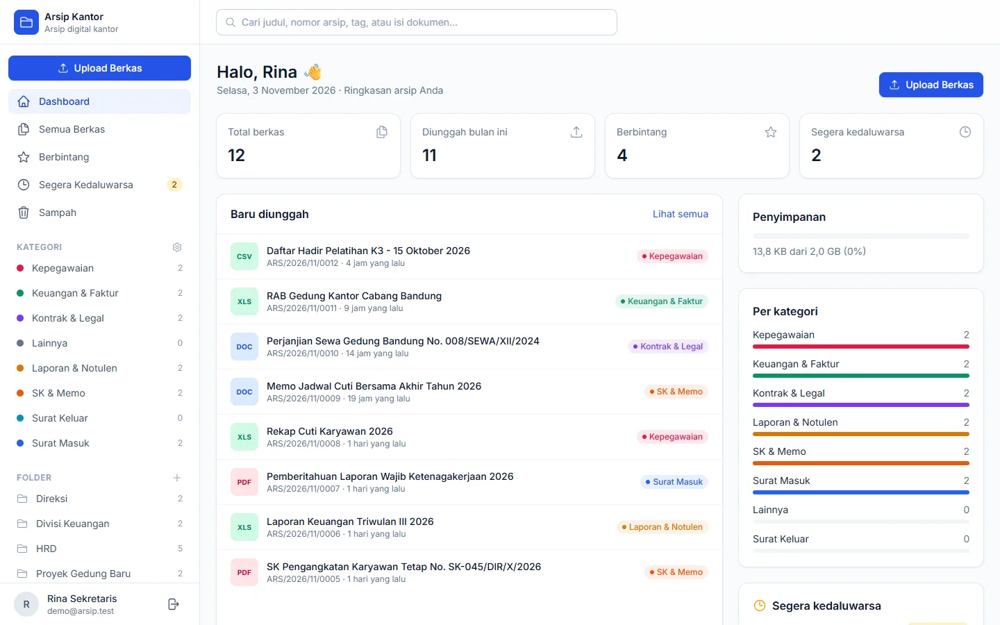
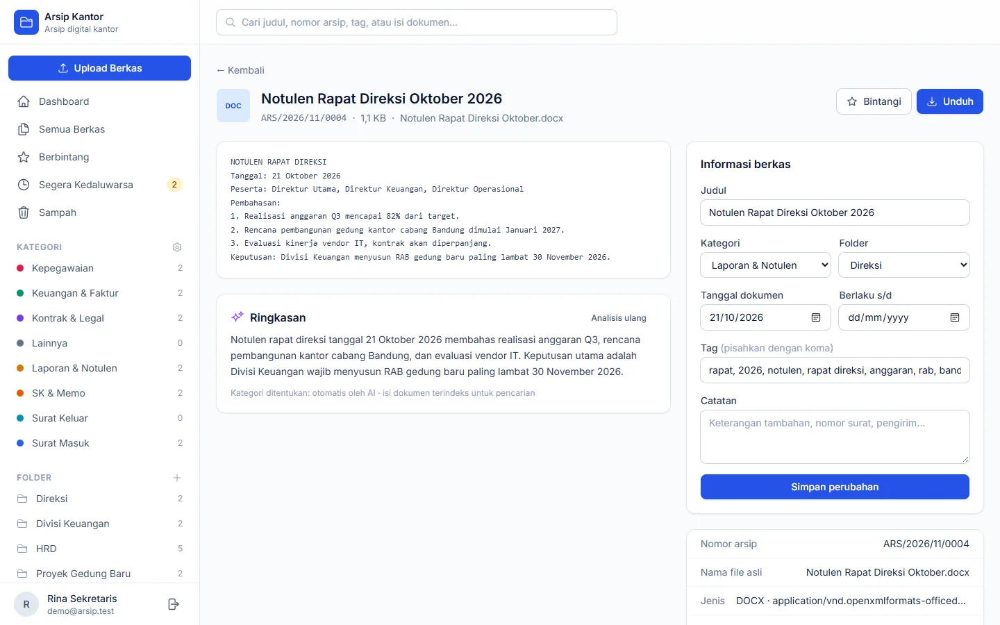
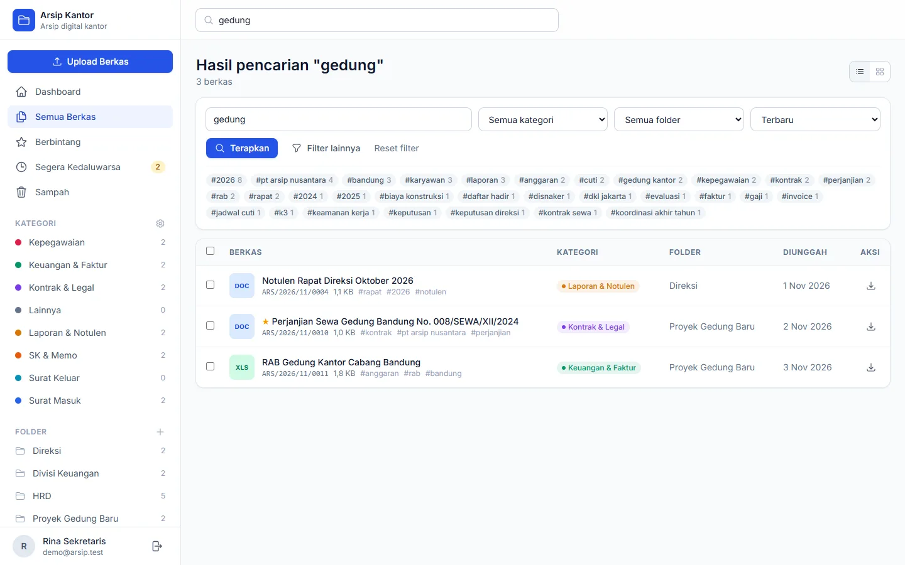

# Arsip Kantor

Aplikasi arsip digital berbasis **Laravel 12** untuk karyawan dan sekretaris: simpan, pisahkan, saring, dan temukan berkas kantor dengan cepat.



| Ringkasan AI per berkas | Pencarian isi dokumen |
|---|---|
|  |  |

## Fitur

| Fitur | Keterangan |
|---|---|
| **Upload massal drag & drop** | Seret banyak berkas sekaligus; progres per berkas, 3 upload paralel. |
| **Nomor arsip otomatis** | Format `ARS/2026/11/0001`, berurutan per bulan (awalan bisa diubah). |
| **Auto-kategori** | Berkas dikelompokkan otomatis (Surat Masuk/Keluar, Keuangan & Faktur, Kontrak & Legal, Laporan & Notulen, SK & Memo, Kepegawaian, Lainnya) dari kata kunci di nama file **dan isi dokumen**. Kata kunci bisa diatur sendiri di menu *Atur Kategori*. |
| **AI ringkasan & klasifikasi** | Opsional. Membuat judul rapi, ringkasan 2–3 kalimat, tag, serta membaca tanggal dokumen & tanggal berakhir. Bisa memakai API format OpenAI (mis. BazaarLink/Qwen) atau Claude; mode Claude juga bisa membaca **PDF hasil scan dan foto dokumen**. |
| **Pencarian isi dokumen** | Cari di judul, nomor arsip, tag, catatan, ringkasan, dan teks di dalam PDF, Word, Excel, PowerPoint, TXT/CSV. |
| **Filter lengkap** | Kategori, folder, tag, jenis berkas, rentang tanggal, berbintang, segera kedaluwarsa; urutkan berdasarkan tanggal, judul, ukuran, nomor arsip. |
| **Folder & tag** | Pisahkan per divisi/proyek/tahun; tag bebas per berkas. |
| **Pengingat kedaluwarsa** | Kontrak, izin, dan tagihan yang berakhir ≤ 30 hari tampil di dashboard dan sidebar. |
| **Aksi massal** | Pilih banyak berkas → ubah kategori, pindah folder, bintangi, hapus. |
| **Sampah** | Berkas yang dihapus bisa dipulihkan atau dihapus permanen. |
| **Aman** | Tiap user hanya melihat berkasnya sendiri; berkas disimpan di luar folder publik; file PHP/HTML/SVG/EXE ditolak; pratinjau hanya untuk tipe aman. |

## Kebutuhan

- PHP 8.2+ (ekstensi: `pdo_sqlite`, `fileinfo`, `zip`, `mbstring`) — PHP bawaan XAMPP sudah cukup
- Composer 2
- Node.js 20+ (hanya untuk build tampilan)

## Instalasi

```bash
composer install
cp .env.example .env
php artisan key:generate
touch database/database.sqlite      # Windows: type nul > database\database.sqlite
php artisan migrate
npm install
npm run build
php artisan serve
```

Buka http://localhost:8000, klik **Daftar**, lalu mulai upload. Kategori standar otomatis dibuat untuk setiap akun baru.

## Mengaktifkan AI (opsional)

Aplikasi mendukung dua jenis penyedia AI, dipilih lewat `AI_PROVIDER` di `.env`.

**API format OpenAI (default), misalnya BazaarLink:**
```env
AI_PROVIDER=openai
AI_BASE_URL=https://api.bazaarlink.ai/v1
AI_API_KEY=sk-bl-...
AI_MODEL=qwen/qwen3.7-flash:free
```
Model `:free` di BazaarLink tidak bisa dipakai jika key dalam mode ZDR (zero data retention); matikan ZDR di halaman API keys, atau pilih model dari `GET /v1/models?zdr=only`. Penyedia lain yang kompatibel OpenAI (OpenRouter, dll.) cukup ganti `AI_BASE_URL` dan `AI_MODEL`.

**Claude (Anthropic):**
```env
AI_PROVIDER=anthropic
ANTHROPIC_API_KEY=sk-ant-...
ANTHROPIC_MODEL=claude-opus-5-5
```
Hanya mode Claude yang bisa membaca PDF hasil scan dan foto dokumen secara langsung; mode OpenAI memakai teks hasil ekstraksi (untuk scan hanya menebak dari nama file).

Setelah mengubah `.env`, jalankan `php artisan config:clear` dan jalankan ulang server.

Tanpa API key, auto-kategori kata kunci tetap berjalan. Jika AI gagal (key salah, kuota habis, jaringan putus), hasil kata kunci tetap dipakai dan alasannya ditampilkan di halaman berkas. Tombol **Analisis ulang** di halaman berkas menjalankan ulang analisis.

Catatan biaya: setiap upload memanggil AI satu kali. Untuk dokumen yang sangat panjang, hanya ±60.000 karakter awal yang dikirim — cukup untuk mengenali jenis dokumen.

### Analisis di latar belakang

Secara default (`QUEUE_CONNECTION=sync`) analisis berjalan langsung saat upload, sehingga hasil kategori langsung terlihat. Untuk upload ratusan berkas dengan AI, ubah ke `QUEUE_CONNECTION=database` lalu jalankan worker:

```bash
php artisan queue:work
```

## Pengaturan lain (`.env`)

| Variabel | Default | Arti |
|---|---|---|
| `ARCHIVE_PREFIX` | `ARS` | Awalan nomor arsip |
| `ARCHIVE_MAX_UPLOAD_KB` | `20480` | Batas ukuran per berkas (20 MB). `upload_max_filesize` dan `post_max_size` di `php.ini` harus ≥ nilai ini |
| `ARCHIVE_QUOTA_MB` | `2048` | Kuota yang ditampilkan di dashboard |
| `APP_TIMEZONE` | `Asia/Jakarta` | Zona waktu |

## Struktur kode

```
app/
  Http/Controllers/     DocumentController (upload, daftar, filter, massal, unduh, pratinjau),
                        CategoryController, FolderController, DashboardController, Auth/AuthController
  Jobs/AnalyzeDocument  ekstraksi teks → kata kunci → AI (opsional)
  Services/             TextExtractor, KeywordClassifier, AiClassifier, ArchiveNumberGenerator
  Models/               Document, Category, Folder, Tag, User
resources/views/        tampilan Blade (Tailwind CSS + Alpine.js)
resources/js/uploader.js  upload drag & drop
storage/app/private/documents/{user}/{tahun}/{bulan}/   lokasi berkas tersimpan
```

## Pengujian

```bash
php artisan test
```

Made by [whympxx](https://github.com/whympxx).
